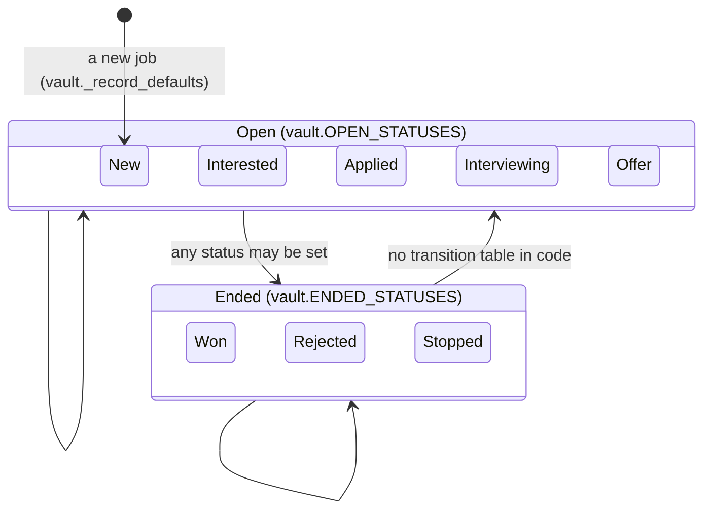
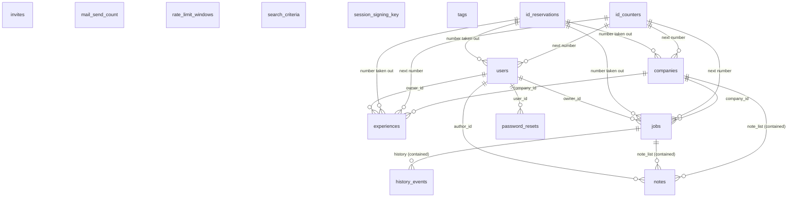

GENERATED by scripts/gen_docs.py from careeros.vault, careeros.history, careeros.users, careeros.invites, careeros.password_reset, careeros.tokens, careeros.ratelimit, careeros.mail, and the url map and handler sources of careeros.server. Do not edit. Regenerate with python scripts/gen_docs.py.

# As-built data model

What this app stores, who may read and write it, and how the kinds link. Every table, every diagram and every count on this page is read out of the sources named in the first line, which is why the file is generated rather than written: a field, a status, an event type or a route that is added, moved or removed shows up here on the next run. Where a fact cannot be read out of the code, the page says so rather than filling the gap.

## Record kinds

Everything this app stores in a vault, one block per kind. The storage location is read off the function that writes the kind: the filename of a numbered record is printed as the expression that builds it, and a single-file kind is named by the `Path(root) / ...` expression in its own reader. The allowed fields are the allowlist in code and never the fields a stored record happens to carry, so a field an older record holds and no writer accepts any more is absent here, which is the honest answer: a write would drop it. A kind whose writer checks no field list at all says so. The scope is read off the field that says whose record it is (`vault.OWNER_FIELD` for a job or an experience, `author_id` for a note), off the record a contained kind lives inside, and for a kind with none of those off the permissions matrix below.

Beside the allowlist, a block lists the fields the writer sets itself. Those sit outside the allowlist, which is what makes them the vault's own: no payload can set them, and a job's `history` is the clearest case, a stored field a client can neither write nor edit. A save also reaches past its own kind inside the storage layer: saving a job appends a history event, can register a proposed tag value through `vault.validate_tags`, and regenerates the linked company rollup through `enrich.regenerate_company` when `enrich.contributes_to_shared` allows it.

### companies

* Stored at: `companies/`, one file per record, named `f"{slugify(result[required])}-{result['id'].lower()}.yaml"` (vault._save_record).
* Allowed fields (vault.company_field_names): `contact_email`, `custom`, `enrichment`, `field_provenance`, `identifiers`, `kind`, `locations`, `name`, `name_source`, `note_list`, `notes`, `retired`, `retired_at`, `review_flags`, `sector`, `sectors`, `size`, `size_class`, `size_range`, `sources`, `website`.
* Fields the writer sets itself, outside the allowlist: `id`.
* Scope: no owner or author field in its allowlist, so nothing in the record says whose it is. Read on routes whose read access reads: any logged-in user. Written on routes whose write access reads: admin only; any logged-in user.

### experiences

* Stored at: `experiences/`, one file per record, named `f"{slugify(result['company'] + ' ' + result['title'])}-{result['id'].lower()}.yaml"` (vault.save_experience).
* Allowed fields (vault.validate_experience defaults): `company`, `company_id`, `custom`, `detail`, `end`, `highlights`, `location`, `owner_id`, `people_led`, `skills`, `start`, `summary`, `tags`, `title`.
* Fields the writer sets itself, outside the allowlist: `id`, `salary`.
* Scope: per user, by `owner_id`. Read through `vault.Owner`, which answers for somebody else's record exactly as it answers for one that does not exist.

### history events

* Stored at: inside `history` on a job record, the latest 50 entries (vault.append_event).
* Allowed fields (vault.append_event entry): `detail`, `event`, `ts`.
* Scope: whatever the record holding it is scoped to (jobs), because it is a field of that record and not a record of its own. Read through `vault.Owner`, which answers for somebody else's record exactly as it answers for one that does not exist.

### id counters

* Stored at: `ids.yaml` (vault._allocate).
* Allowed fields (vault.ID_PREFIXES): `companies`, `experiences`, `jobs`, `users`.
* Scope: no owner or author field in its allowlist, so nothing in the record says whose it is. No Flask route reads it. Written on routes whose write access reads: admin only; any logged-in user; public, one-time token, rate limited.

### id reservations

* Stored at: the record directory of the kind the number belongs to, named `f'{RESERVED_PREFIX}{str(identifier).lower()}.yaml'` (vault.reserve_id).
* Allowed fields (vault.reserve_id): `id`, `reserved`.
* Scope: no owner or author field in its allowlist, so nothing in the record says whose it is. No Flask route reads it. Written on routes whose write access reads: admin only.

### invites

* Stored at: `invites/`, one file per token, named `f'{token_hash(token)}.yaml'` (invites.FOLDER, tokens.storage_path).
* Allowed fields (invites.create_invite record, plus tokens.consume): `created_at`, `email`, `expires_at`, `name`, `token_hash`, `used_at`.
* Scope: no owner or author field in its allowlist, so nothing in the record says whose it is. Read on routes whose read access reads: public, one-time token, rate limited. Written on routes whose write access reads: public, one-time token, rate limited.

### jobs

* Stored at: `jobs/`, one file per record, named `f"{slugify(result[required])}-{result['id'].lower()}.yaml"` (vault._save_record).
* Allowed fields (vault.job_field_names): `added`, `ai_error`, `ai_finished`, `ai_started`, `ai_status`, `ats_posting_id`, `ats_provider`, `ats_tenant`, `background`, `certifications`, `closed`, `closed_at`, `closed_reviewed_at`, `company`, `company_id`, `company_link_reason`, `company_link_state`, `company_review`, `contact_email`, `custom`, `description`, `description_structured`, `employee_count`, `employer_named_in_posting`, `employment_type`, `end_reason`, `enriched`, `field_provenance`, `field_status`, `field_status_reason`, `function`, `in_pipeline`, `industries`, `industry`, `ingest_error`, `ingest_source`, `ingest_state`, `keywords`, `location`, `normalized_url`, `note_list`, `notes`, `occupation_code`, `origin`, `original_url`, `owner_id`, `posted_date`, `posting_quality`, `refresh`, `remote_ok`, `requirement_groups`, `responsibilities`, `salary`, `salary_info`, `salary_note`, `sector`, `sectors`, `seniority`, `skill_codes`, `skills`, `source`, `source_id`, `status`, `summary`, `summary_source`, `tags`, `title`, `url`, `valid_through`, `values`.
* Fields the writer sets itself, outside the allowlist: `history`, `id`, `status_changed`, `watch`.
* Scope: per user, by `owner_id`. Read through `vault.Owner`, which answers for somebody else's record exactly as it answers for one that does not exist.

### mail send count

* Stored at: `mail/count.yaml` (mail._record_sent).
* Allowed fields (mail._record_sent): `count`, `date`.
* Scope: no owner or author field in its allowlist, so nothing in the record says whose it is. Read on routes whose read access reads: public, rate limited. Written on routes whose write access reads: public, rate limited.

### notes

* Stored at: inside `note_list` on a job or a company record (vault.notes_view, vault.notes_payload).
* Allowed fields (vault.NOTE_FIELDS): `author_id`, `body`, `created`, `id`, `title`, `updated`.
* Scope: per author, by `author_id`. Read through `vault.Owner`, which answers for somebody else's record exactly as it answers for one that does not exist.

### password resets

* Stored at: `resets/`, one file per token, named `f'{token_hash(token)}.yaml'` (password_reset.FOLDER, tokens.storage_path).
* Allowed fields (password_reset.request_reset record, plus tokens.consume): `created_at`, `email`, `expires_at`, `token_hash`, `used_at`, `user_id`.
* Scope: no owner or author field in its allowlist, so nothing in the record says whose it is. Read on routes whose read access reads: public, one-time token, rate limited. Written on routes whose write access reads: public, one-time token, rate limited; public, rate limited.

### rate-limit windows

* Stored at: `ratelimit/windows.yaml` (ratelimit.hit).
* Allowed fields (ratelimit.hit): `count`, `until`, `windows`.
* Scope: no owner or author field in its allowlist, so nothing in the record says whose it is. No Flask route reads it. Written on routes whose write access reads: public, one-time token, rate limited; public, rate limited.

### search criteria

* Stored at: `search.yaml` (vault.load_search).
* Allowed fields (vault.blank_search): `avoid`, `must_haves`, `nice_to_haves`, `notes`, `roles`, `updated`.
* Scope: no owner or author field in its allowlist, so nothing in the record says whose it is. Read on routes whose read access reads: any logged-in user. Written on routes whose write access reads: any logged-in user.

### session signing key

* Stored at: `secret_key`, mode 0o600 (users.secret_key).
* Allowed fields (not a mapping: users.secret_key writes one value): none listed in code.
* Scope: no owner or author field in its allowlist, so nothing in the record says whose it is. No Flask route reads it. No Flask route writes it: the vault keeps it for the host.

### tags

* Stored at: `tags.yaml` (vault.load_tags).
* Allowed fields (no allowlist found in code: vault.save_tags requires a facets object and stores what it is given): none listed in code.
* Scope: no owner or author field in its allowlist, so nothing in the record says whose it is. Read on routes whose read access reads: any logged-in user. Written on routes whose write access reads: admin only; any logged-in user.

### users

* Stored at: `users/`, one file per record, named `f"{vault.slugify(result['name'])}-{result['id'].lower()}.yaml"` (users.save_user).
* Allowed fields (users.validate_user defaults): `created_at`, `disabled`, `email`, `name`, `password_hash`, `role`, `session_epoch`.
* Fields the writer sets itself, outside the allowlist: `id`.
* Scope: no owner or author field in its allowlist, so nothing in the record says whose it is. Read on routes whose read access reads: any logged-in user; public; public, one-time token, rate limited; public, rate limited. Written on routes whose write access reads: public, one-time token, rate limited.

## Permissions matrix

One row per Flask rule and record kind, over the same url map routes.md reads. The kinds are what the route can reach: the handler, and every careeros function it names through its own globals or closure, resolved name by name. Read that as an upper bound in two directions. A function reached on one branch counts as reached, and a save of one kind reaches another inside the storage layer, which is what the `Reached from` column is for: `route code` means the symbol is named by the handler or by a careeros.server or careeros.web helper it calls, and `storage layer` means it was reached underneath that, so the route does not necessarily take a payload for that kind. The one blind spot in the other direction is a call this walk cannot resolve to a function, which is why the symbols behind every row are printed as its evidence.

The access columns say what the request gate and the admin rule let through on that route. `public` is an endpoint in `careeros.server PUBLIC_ENDPOINTS`, which the gate lets through without a session, and the further gate such a route does apply is named beside it. `owner only` is a kind that carries an owner or an author, on a route whose own code builds the ownership scope every private read is filtered through; a route that reached such a kind without building one in its own code would abort this generator rather than appear here with a guess, and a kind reached only underneath a save carries the rule of the record that holds it. `admin only` is a shared write on a route whose handler consults the admin rule (`may_edit_shared`, `shared_denied`), which is the same reading routes.md takes, and it carries the same caveat: it says the handler applies that rule to the shared write it makes, not that every kind on the row and every method on the route is the admin's. A delete is the clearest case, because taking an id out of circulation (`id counters`, `id reservations`) happens on the same route and no admin rule guards it. A shared write with no such reading anywhere in the handler is every logged-in user's, which is the true answer for a company note. Every row that is not public also reads the signed-in user's own record, because the gate does (`careeros.server require_login`); that read is stated here once instead of on every row that needs it.

| Path | Methods | Endpoint | Record kind | Read access | Write access | Reached from | Storage symbols |
|---|---|---|---|---|---|---|---|
| `/` | GET | `react_index` | none | no record kind on this route | no write on this route |  |  |
| `/accept-invite/<token>` | GET, POST | `accept_invite` | id counters | no read on this route | public, one-time token, rate limited | storage layer | `vault._allocate` |
| `/accept-invite/<token>` | GET, POST | `accept_invite` | invites | public, one-time token, rate limited | public, one-time token, rate limited | route code | `invites.accept`, `invites.load` |
| `/accept-invite/<token>` | GET, POST | `accept_invite` | rate-limit windows | no read on this route | public, one-time token, rate limited | route code | `ratelimit.register` |
| `/accept-invite/<token>` | GET, POST | `accept_invite` | users | public, one-time token, rate limited | public, one-time token, rate limited | storage layer | `users.create_user`, `users.find_by_email`, `users.save_user` |
| `/all-jobs` | GET | `react_all_jobs` | none | no record kind on this route | no write on this route |  |  |
| `/api/companies` | GET | `company_collection` | companies | any logged-in user | no write on this route | route code, storage layer | `vault.list_companies`, `vault.reader_company`, `vault.visible_companies` |
| `/api/companies` | GET | `company_collection` | experiences | owner only | no write on this route | storage layer | `vault.list_experiences` |
| `/api/companies` | GET | `company_collection` | jobs | owner only | no write on this route | route code, storage layer | `vault.list_jobs`, `vault.list_universe_jobs` |
| `/api/companies/<identifier>` | DELETE, GET, PUT | `company_api` | companies | any logged-in user | admin only | route code, storage layer | `vault.delete_company`, `vault.linkable_company`, `vault.list_companies`, `vault.load_company`, `vault.may_see_company`, `vault.reader_company`, `vault.retire_company`, `vault.save_company`, `vault.visible_companies` |
| `/api/companies/<identifier>` | DELETE, GET, PUT | `company_api` | experiences | owner only | no write on this route | route code, storage layer | `vault.list_experiences` |
| `/api/companies/<identifier>` | DELETE, GET, PUT | `company_api` | history events | no read on this route | owner only | storage layer | `vault.append_event` |
| `/api/companies/<identifier>` | DELETE, GET, PUT | `company_api` | id counters | no read on this route | admin only | storage layer | `vault._allocate`, `vault.retain_id_high_water` |
| `/api/companies/<identifier>` | DELETE, GET, PUT | `company_api` | id reservations | no read on this route | admin only | storage layer | `vault.reserve_id` |
| `/api/companies/<identifier>` | DELETE, GET, PUT | `company_api` | jobs | owner only | no write on this route | route code, storage layer | `vault.list_jobs`, `vault.list_owned_jobs` |
| `/api/companies/<identifier>` | DELETE, GET, PUT | `company_api` | notes | owner only | no write on this route | route code, storage layer | `vault.has_notes`, `vault.notes_view` |
| `/api/companies/<identifier>` | DELETE, GET, PUT | `company_api` | tags | any logged-in user | admin only | storage layer | `vault.known_function_ids`, `vault.load_tags`, `vault.save_tags`, `vault.validate_tags` |
| `/api/companies/<identifier>/enrich` | POST | `enrich_company` | companies | any logged-in user | admin only | route code, storage layer | `vault.linkable_company`, `vault.list_companies`, `vault.load_company`, `vault.may_see_company`, `vault.reader_company`, `vault.save_company`, `vault.visible_companies` |
| `/api/companies/<identifier>/enrich` | POST | `enrich_company` | experiences | owner only | no write on this route | storage layer | `vault.list_experiences` |
| `/api/companies/<identifier>/enrich` | POST | `enrich_company` | history events | no read on this route | owner only | storage layer | `vault.append_event` |
| `/api/companies/<identifier>/enrich` | POST | `enrich_company` | id counters | no read on this route | admin only | storage layer | `vault._allocate` |
| `/api/companies/<identifier>/enrich` | POST | `enrich_company` | jobs | owner only | no write on this route | storage layer | `vault.list_jobs` |
| `/api/companies/<identifier>/enrich` | POST | `enrich_company` | notes | owner only | no write on this route | storage layer | `vault.has_notes`, `vault.notes_view` |
| `/api/companies/<identifier>/enrich` | POST | `enrich_company` | tags | any logged-in user | admin only | storage layer | `vault.known_function_ids`, `vault.load_tags`, `vault.save_tags`, `vault.validate_tags` |
| `/api/companies/<identifier>/enrich` | POST | `enrich_company` | users | any logged-in user | no write on this route | storage layer | `users.list_users` |
| `/api/companies/<identifier>/notes` | POST | `create_note` | companies | any logged-in user | any logged-in user | route code, storage layer | `vault.linkable_company`, `vault.list_companies`, `vault.load_company`, `vault.may_see_company`, `vault.reader_company`, `vault.save_company`, `vault.visible_companies` |
| `/api/companies/<identifier>/notes` | POST | `create_note` | experiences | owner only | no write on this route | storage layer | `vault.list_experiences` |
| `/api/companies/<identifier>/notes` | POST | `create_note` | history events | no read on this route | owner only | storage layer | `vault.append_event` |
| `/api/companies/<identifier>/notes` | POST | `create_note` | id counters | no read on this route | any logged-in user | storage layer | `vault._allocate` |
| `/api/companies/<identifier>/notes` | POST | `create_note` | jobs | owner only | owner only | route code, storage layer | `vault.list_jobs`, `vault.load_job`, `vault.save_job` |
| `/api/companies/<identifier>/notes` | POST | `create_note` | notes | owner only | owner only | route code, storage layer | `vault.has_notes`, `vault.new_note`, `vault.notes_payload`, `vault.notes_view` |
| `/api/companies/<identifier>/notes` | POST | `create_note` | tags | any logged-in user | any logged-in user | storage layer | `vault.known_function_ids`, `vault.load_tags`, `vault.save_tags`, `vault.validate_tags` |
| `/api/companies/<identifier>/notes` | POST | `create_note` | users | any logged-in user | no write on this route | storage layer | `users.list_users` |
| `/api/companies/<identifier>/notes/<note_id>` | DELETE, PATCH | `note_api` | companies | any logged-in user | any logged-in user | route code, storage layer | `vault.linkable_company`, `vault.list_companies`, `vault.load_company`, `vault.may_see_company`, `vault.reader_company`, `vault.save_company`, `vault.visible_companies` |
| `/api/companies/<identifier>/notes/<note_id>` | DELETE, PATCH | `note_api` | experiences | owner only | no write on this route | storage layer | `vault.list_experiences` |
| `/api/companies/<identifier>/notes/<note_id>` | DELETE, PATCH | `note_api` | history events | no read on this route | owner only | storage layer | `vault.append_event` |
| `/api/companies/<identifier>/notes/<note_id>` | DELETE, PATCH | `note_api` | id counters | no read on this route | any logged-in user | storage layer | `vault._allocate` |
| `/api/companies/<identifier>/notes/<note_id>` | DELETE, PATCH | `note_api` | jobs | owner only | owner only | route code, storage layer | `vault.list_jobs`, `vault.load_job`, `vault.save_job` |
| `/api/companies/<identifier>/notes/<note_id>` | DELETE, PATCH | `note_api` | notes | owner only | owner only | route code, storage layer | `vault.edit_note`, `vault.has_notes`, `vault.notes_payload`, `vault.notes_view` |
| `/api/companies/<identifier>/notes/<note_id>` | DELETE, PATCH | `note_api` | tags | any logged-in user | any logged-in user | storage layer | `vault.known_function_ids`, `vault.load_tags`, `vault.save_tags`, `vault.validate_tags` |
| `/api/companies/<identifier>/notes/<note_id>` | DELETE, PATCH | `note_api` | users | any logged-in user | no write on this route | storage layer | `users.list_users` |
| `/api/companies/<identifier>/retry` | POST | `retry_company` | companies | any logged-in user | admin only | route code, storage layer | `vault.linkable_company`, `vault.list_companies`, `vault.load_company`, `vault.may_see_company`, `vault.reader_company`, `vault.save_company`, `vault.visible_companies` |
| `/api/companies/<identifier>/retry` | POST | `retry_company` | experiences | owner only | no write on this route | storage layer | `vault.list_experiences` |
| `/api/companies/<identifier>/retry` | POST | `retry_company` | history events | no read on this route | owner only | storage layer | `vault.append_event` |
| `/api/companies/<identifier>/retry` | POST | `retry_company` | id counters | no read on this route | admin only | storage layer | `vault._allocate` |
| `/api/companies/<identifier>/retry` | POST | `retry_company` | jobs | owner only | no write on this route | storage layer | `vault.list_jobs` |
| `/api/companies/<identifier>/retry` | POST | `retry_company` | notes | owner only | no write on this route | storage layer | `vault.has_notes`, `vault.notes_view` |
| `/api/companies/<identifier>/retry` | POST | `retry_company` | tags | any logged-in user | admin only | storage layer | `vault.known_function_ids`, `vault.load_tags`, `vault.save_tags`, `vault.validate_tags` |
| `/api/companies/backfill-sector-size` | POST | `backfill_sector_size` | companies | any logged-in user | admin only | storage layer | `vault.linkable_company`, `vault.list_companies`, `vault.load_company`, `vault.save_company` |
| `/api/companies/backfill-sector-size` | POST | `backfill_sector_size` | history events | no read on this route | owner only | storage layer | `vault.append_event` |
| `/api/companies/backfill-sector-size` | POST | `backfill_sector_size` | id counters | no read on this route | admin only | storage layer | `vault._allocate` |
| `/api/companies/backfill-sector-size` | POST | `backfill_sector_size` | notes | owner only | no write on this route | storage layer | `vault.has_notes`, `vault.notes_view` |
| `/api/companies/backfill-sector-size` | POST | `backfill_sector_size` | tags | any logged-in user | admin only | storage layer | `vault.known_function_ids`, `vault.load_tags`, `vault.save_tags`, `vault.validate_tags` |
| `/api/experiences` | GET, POST | `experience_collection` | companies | any logged-in user | no write on this route | route code, storage layer | `vault.linkable_company`, `vault.list_companies`, `vault.load_company`, `vault.reader_company`, `vault.visible_companies` |
| `/api/experiences` | GET, POST | `experience_collection` | experiences | owner only | owner only | route code, storage layer | `vault.list_experiences`, `vault.save_experience` |
| `/api/experiences` | GET, POST | `experience_collection` | id counters | no read on this route | admin only | storage layer | `vault._allocate` |
| `/api/experiences` | GET, POST | `experience_collection` | jobs | owner only | no write on this route | storage layer | `vault.list_jobs` |
| `/api/experiences` | GET, POST | `experience_collection` | tags | any logged-in user | admin only | route code, storage layer | `vault.load_tags`, `vault.save_tags`, `vault.tag_label_map`, `vault.unregistered_tags`, `vault.validate_tags` |
| `/api/experiences/<identifier>` | DELETE, GET, POST, PUT | `experience_api` | companies | any logged-in user | no write on this route | route code, storage layer | `vault.linkable_company`, `vault.list_companies`, `vault.load_company`, `vault.reader_company`, `vault.visible_companies` |
| `/api/experiences/<identifier>` | DELETE, GET, POST, PUT | `experience_api` | experiences | owner only | owner only | route code, storage layer | `vault.delete_experience`, `vault.list_experiences`, `vault.load_experience`, `vault.save_experience` |
| `/api/experiences/<identifier>` | DELETE, GET, POST, PUT | `experience_api` | id counters | no read on this route | admin only | storage layer | `vault._allocate`, `vault.retain_id_high_water` |
| `/api/experiences/<identifier>` | DELETE, GET, POST, PUT | `experience_api` | id reservations | no read on this route | admin only | storage layer | `vault.reserve_id` |
| `/api/experiences/<identifier>` | DELETE, GET, POST, PUT | `experience_api` | jobs | owner only | no write on this route | storage layer | `vault.list_jobs` |
| `/api/experiences/<identifier>` | DELETE, GET, POST, PUT | `experience_api` | tags | any logged-in user | admin only | route code, storage layer | `vault.load_tags`, `vault.save_tags`, `vault.tag_label_map`, `vault.unregistered_tags`, `vault.validate_tags` |
| `/api/experiences/<identifier>/edit` | GET | `experience_form_api` | companies | any logged-in user | no write on this route | route code, storage layer | `vault.list_companies`, `vault.reader_company`, `vault.visible_companies` |
| `/api/experiences/<identifier>/edit` | GET | `experience_form_api` | experiences | owner only | no write on this route | route code, storage layer | `vault.list_experiences`, `vault.load_experience` |
| `/api/experiences/<identifier>/edit` | GET | `experience_form_api` | jobs | owner only | no write on this route | storage layer | `vault.list_jobs` |
| `/api/experiences/<identifier>/edit` | GET | `experience_form_api` | tags | any logged-in user | no write on this route | route code | `vault.load_tags` |
| `/api/experiences/<identifier>/link-company` | POST | `link_experience_company` | companies | any logged-in user | admin only | route code, storage layer | `vault.linkable_company`, `vault.list_companies`, `vault.load_company`, `vault.may_see_company`, `vault.reader_company`, `vault.save_company`, `vault.visible_companies` |
| `/api/experiences/<identifier>/link-company` | POST | `link_experience_company` | experiences | owner only | owner only | route code, storage layer | `vault.list_experiences`, `vault.load_experience`, `vault.save_experience` |
| `/api/experiences/<identifier>/link-company` | POST | `link_experience_company` | history events | no read on this route | owner only | storage layer | `vault.append_event` |
| `/api/experiences/<identifier>/link-company` | POST | `link_experience_company` | id counters | no read on this route | admin only | storage layer | `vault._allocate` |
| `/api/experiences/<identifier>/link-company` | POST | `link_experience_company` | jobs | owner only | no write on this route | storage layer | `vault.list_jobs` |
| `/api/experiences/<identifier>/link-company` | POST | `link_experience_company` | notes | owner only | no write on this route | storage layer | `vault.has_notes`, `vault.notes_view` |
| `/api/experiences/<identifier>/link-company` | POST | `link_experience_company` | tags | any logged-in user | admin only | storage layer | `vault.known_function_ids`, `vault.load_tags`, `vault.save_tags`, `vault.validate_tags` |
| `/api/experiences/new` | GET | `experience_form_api` | companies | any logged-in user | no write on this route | route code, storage layer | `vault.list_companies`, `vault.reader_company`, `vault.visible_companies` |
| `/api/experiences/new` | GET | `experience_form_api` | experiences | owner only | no write on this route | route code, storage layer | `vault.list_experiences`, `vault.load_experience` |
| `/api/experiences/new` | GET | `experience_form_api` | jobs | owner only | no write on this route | storage layer | `vault.list_jobs` |
| `/api/experiences/new` | GET | `experience_form_api` | tags | any logged-in user | no write on this route | route code | `vault.load_tags` |
| `/api/health` | GET | `health` | none | no record kind on this route | no write on this route |  |  |
| `/api/jobs` | GET | `job_collection` | companies | any logged-in user | no write on this route | route code, storage layer | `vault.list_companies`, `vault.reader_company`, `vault.visible_companies` |
| `/api/jobs` | GET | `job_collection` | experiences | owner only | no write on this route | storage layer | `vault.list_experiences` |
| `/api/jobs` | GET | `job_collection` | jobs | owner only | no write on this route | route code, storage layer | `vault.list_jobs`, `vault.list_universe_jobs` |
| `/api/jobs` | GET | `job_collection` | tags | any logged-in user | no write on this route | route code, storage layer | `vault.function_facet_options`, `vault.function_label_map`, `vault.load_tags` |
| `/api/jobs/<identifier>` | DELETE, GET, PUT | `job_api` | companies | any logged-in user | admin only | route code, storage layer | `vault.linkable_company`, `vault.load_company`, `vault.reader_company`, `vault.save_company` |
| `/api/jobs/<identifier>` | DELETE, GET, PUT | `job_api` | history events | owner only | owner only | route code, storage layer | `history.label_for`, `history.resolve`, `vault.append_event` |
| `/api/jobs/<identifier>` | DELETE, GET, PUT | `job_api` | id counters | no read on this route | admin only | storage layer | `vault._allocate`, `vault.retain_id_high_water` |
| `/api/jobs/<identifier>` | DELETE, GET, PUT | `job_api` | id reservations | no read on this route | admin only | storage layer | `vault.reserve_id` |
| `/api/jobs/<identifier>` | DELETE, GET, PUT | `job_api` | jobs | owner only | owner only | route code, storage layer | `vault.delete_job`, `vault.list_jobs`, `vault.load_job`, `vault.save_job` |
| `/api/jobs/<identifier>` | DELETE, GET, PUT | `job_api` | notes | owner only | no write on this route | route code, storage layer | `vault.has_notes`, `vault.notes_view` |
| `/api/jobs/<identifier>` | DELETE, GET, PUT | `job_api` | tags | any logged-in user | admin only | route code, storage layer | `vault.function_facet_options`, `vault.function_label_map`, `vault.known_function_ids`, `vault.load_tags`, `vault.save_tags`, `vault.unregistered_tags`, `vault.validate_tags` |
| `/api/jobs/<identifier>` | DELETE, GET, PUT | `job_api` | users | any logged-in user | no write on this route | storage layer | `users.list_users` |
| `/api/jobs/<identifier>/enrich` | POST | `enrich_job` | companies | any logged-in user | any logged-in user | route code, storage layer | `vault.linkable_company`, `vault.list_companies`, `vault.load_company`, `vault.save_company` |
| `/api/jobs/<identifier>/enrich` | POST | `enrich_job` | history events | no read on this route | owner only | storage layer | `vault.append_event` |
| `/api/jobs/<identifier>/enrich` | POST | `enrich_job` | id counters | no read on this route | any logged-in user | storage layer | `vault._allocate` |
| `/api/jobs/<identifier>/enrich` | POST | `enrich_job` | jobs | owner only | owner only | route code, storage layer | `vault.list_jobs`, `vault.load_job`, `vault.save_job` |
| `/api/jobs/<identifier>/enrich` | POST | `enrich_job` | notes | owner only | no write on this route | storage layer | `vault.has_notes`, `vault.notes_view` |
| `/api/jobs/<identifier>/enrich` | POST | `enrich_job` | tags | any logged-in user | any logged-in user | route code, storage layer | `vault.function_facet_options`, `vault.known_function_ids`, `vault.load_tags`, `vault.save_tags`, `vault.validate_tags` |
| `/api/jobs/<identifier>/enrich` | POST | `enrich_job` | users | any logged-in user | no write on this route | storage layer | `users.admins`, `users.list_users`, `users.load_user` |
| `/api/jobs/<identifier>/extract` | POST | `extract_job` | companies | any logged-in user | any logged-in user | route code, storage layer | `vault.linkable_company`, `vault.load_company`, `vault.save_company` |
| `/api/jobs/<identifier>/extract` | POST | `extract_job` | history events | no read on this route | owner only | storage layer | `vault.append_event` |
| `/api/jobs/<identifier>/extract` | POST | `extract_job` | id counters | no read on this route | any logged-in user | storage layer | `vault._allocate` |
| `/api/jobs/<identifier>/extract` | POST | `extract_job` | jobs | owner only | owner only | route code, storage layer | `vault.list_jobs`, `vault.load_job`, `vault.save_job` |
| `/api/jobs/<identifier>/extract` | POST | `extract_job` | notes | owner only | no write on this route | storage layer | `vault.has_notes`, `vault.notes_view` |
| `/api/jobs/<identifier>/extract` | POST | `extract_job` | tags | any logged-in user | any logged-in user | route code, storage layer | `vault.function_facet_options`, `vault.known_function_ids`, `vault.load_tags`, `vault.save_tags`, `vault.validate_tags` |
| `/api/jobs/<identifier>/extract` | POST | `extract_job` | users | any logged-in user | no write on this route | storage layer | `users.admins`, `users.list_users`, `users.load_user` |
| `/api/jobs/<identifier>/notes` | POST | `create_note` | companies | any logged-in user | any logged-in user | route code, storage layer | `vault.linkable_company`, `vault.list_companies`, `vault.load_company`, `vault.may_see_company`, `vault.reader_company`, `vault.save_company`, `vault.visible_companies` |
| `/api/jobs/<identifier>/notes` | POST | `create_note` | experiences | owner only | no write on this route | storage layer | `vault.list_experiences` |
| `/api/jobs/<identifier>/notes` | POST | `create_note` | history events | no read on this route | owner only | storage layer | `vault.append_event` |
| `/api/jobs/<identifier>/notes` | POST | `create_note` | id counters | no read on this route | any logged-in user | storage layer | `vault._allocate` |
| `/api/jobs/<identifier>/notes` | POST | `create_note` | jobs | owner only | owner only | route code, storage layer | `vault.list_jobs`, `vault.load_job`, `vault.save_job` |
| `/api/jobs/<identifier>/notes` | POST | `create_note` | notes | owner only | owner only | route code, storage layer | `vault.has_notes`, `vault.new_note`, `vault.notes_payload`, `vault.notes_view` |
| `/api/jobs/<identifier>/notes` | POST | `create_note` | tags | any logged-in user | any logged-in user | storage layer | `vault.known_function_ids`, `vault.load_tags`, `vault.save_tags`, `vault.validate_tags` |
| `/api/jobs/<identifier>/notes` | POST | `create_note` | users | any logged-in user | no write on this route | storage layer | `users.list_users` |
| `/api/jobs/<identifier>/notes/<note_id>` | DELETE, PATCH | `note_api` | companies | any logged-in user | any logged-in user | route code, storage layer | `vault.linkable_company`, `vault.list_companies`, `vault.load_company`, `vault.may_see_company`, `vault.reader_company`, `vault.save_company`, `vault.visible_companies` |
| `/api/jobs/<identifier>/notes/<note_id>` | DELETE, PATCH | `note_api` | experiences | owner only | no write on this route | storage layer | `vault.list_experiences` |
| `/api/jobs/<identifier>/notes/<note_id>` | DELETE, PATCH | `note_api` | history events | no read on this route | owner only | storage layer | `vault.append_event` |
| `/api/jobs/<identifier>/notes/<note_id>` | DELETE, PATCH | `note_api` | id counters | no read on this route | any logged-in user | storage layer | `vault._allocate` |
| `/api/jobs/<identifier>/notes/<note_id>` | DELETE, PATCH | `note_api` | jobs | owner only | owner only | route code, storage layer | `vault.list_jobs`, `vault.load_job`, `vault.save_job` |
| `/api/jobs/<identifier>/notes/<note_id>` | DELETE, PATCH | `note_api` | notes | owner only | owner only | route code, storage layer | `vault.edit_note`, `vault.has_notes`, `vault.notes_payload`, `vault.notes_view` |
| `/api/jobs/<identifier>/notes/<note_id>` | DELETE, PATCH | `note_api` | tags | any logged-in user | any logged-in user | storage layer | `vault.known_function_ids`, `vault.load_tags`, `vault.save_tags`, `vault.validate_tags` |
| `/api/jobs/<identifier>/notes/<note_id>` | DELETE, PATCH | `note_api` | users | any logged-in user | no write on this route | storage layer | `users.list_users` |
| `/api/jobs/<identifier>/paste-description` | POST | `paste_description` | companies | any logged-in user | any logged-in user | route code, storage layer | `vault.linkable_company`, `vault.load_company`, `vault.save_company` |
| `/api/jobs/<identifier>/paste-description` | POST | `paste_description` | history events | no read on this route | owner only | storage layer | `vault.append_event` |
| `/api/jobs/<identifier>/paste-description` | POST | `paste_description` | id counters | no read on this route | any logged-in user | storage layer | `vault._allocate` |
| `/api/jobs/<identifier>/paste-description` | POST | `paste_description` | jobs | owner only | owner only | route code, storage layer | `vault.list_jobs`, `vault.load_job`, `vault.save_job` |
| `/api/jobs/<identifier>/paste-description` | POST | `paste_description` | notes | owner only | no write on this route | storage layer | `vault.has_notes`, `vault.notes_view` |
| `/api/jobs/<identifier>/paste-description` | POST | `paste_description` | tags | any logged-in user | any logged-in user | route code, storage layer | `vault.function_facet_options`, `vault.known_function_ids`, `vault.load_tags`, `vault.save_tags`, `vault.validate_tags` |
| `/api/jobs/<identifier>/paste-description` | POST | `paste_description` | users | any logged-in user | no write on this route | storage layer | `users.admins`, `users.list_users`, `users.load_user` |
| `/api/jobs/<identifier>/promote` | POST | `promote_job` | companies | any logged-in user | any logged-in user | storage layer | `vault.linkable_company`, `vault.load_company`, `vault.save_company` |
| `/api/jobs/<identifier>/promote` | POST | `promote_job` | history events | no read on this route | owner only | storage layer | `vault.append_event` |
| `/api/jobs/<identifier>/promote` | POST | `promote_job` | id counters | no read on this route | any logged-in user | storage layer | `vault._allocate` |
| `/api/jobs/<identifier>/promote` | POST | `promote_job` | jobs | owner only | owner only | route code, storage layer | `vault.add_job_to_board`, `vault.list_jobs`, `vault.list_owned_jobs`, `vault.load_universe_job`, `vault.save_job` |
| `/api/jobs/<identifier>/promote` | POST | `promote_job` | notes | owner only | no write on this route | storage layer | `vault.has_notes`, `vault.notes_view` |
| `/api/jobs/<identifier>/promote` | POST | `promote_job` | tags | any logged-in user | any logged-in user | storage layer | `vault.known_function_ids`, `vault.load_tags`, `vault.save_tags`, `vault.validate_tags` |
| `/api/jobs/<identifier>/promote` | POST | `promote_job` | users | any logged-in user | no write on this route | storage layer | `users.list_users` |
| `/api/jobs/<identifier>/re-extract` | POST | `re_extract_job` | companies | any logged-in user | any logged-in user | route code, storage layer | `vault.linkable_company`, `vault.load_company`, `vault.save_company` |
| `/api/jobs/<identifier>/re-extract` | POST | `re_extract_job` | history events | no read on this route | owner only | storage layer | `vault.append_event` |
| `/api/jobs/<identifier>/re-extract` | POST | `re_extract_job` | id counters | no read on this route | any logged-in user | storage layer | `vault._allocate` |
| `/api/jobs/<identifier>/re-extract` | POST | `re_extract_job` | jobs | owner only | owner only | route code, storage layer | `vault.list_jobs`, `vault.load_job`, `vault.save_job` |
| `/api/jobs/<identifier>/re-extract` | POST | `re_extract_job` | notes | owner only | no write on this route | storage layer | `vault.has_notes`, `vault.notes_view` |
| `/api/jobs/<identifier>/re-extract` | POST | `re_extract_job` | tags | any logged-in user | any logged-in user | route code, storage layer | `vault.function_facet_options`, `vault.known_function_ids`, `vault.load_tags`, `vault.save_tags`, `vault.validate_tags` |
| `/api/jobs/<identifier>/re-extract` | POST | `re_extract_job` | users | any logged-in user | no write on this route | storage layer | `users.admins`, `users.list_users`, `users.load_user` |
| `/api/jobs/<identifier>/resolve` | POST | `rerun_resolution` | companies | any logged-in user | any logged-in user | route code, storage layer | `vault.linkable_company`, `vault.load_company`, `vault.save_company` |
| `/api/jobs/<identifier>/resolve` | POST | `rerun_resolution` | history events | no read on this route | owner only | storage layer | `vault.append_event` |
| `/api/jobs/<identifier>/resolve` | POST | `rerun_resolution` | id counters | no read on this route | any logged-in user | storage layer | `vault._allocate` |
| `/api/jobs/<identifier>/resolve` | POST | `rerun_resolution` | jobs | owner only | owner only | route code, storage layer | `vault.list_jobs`, `vault.load_job`, `vault.save_job` |
| `/api/jobs/<identifier>/resolve` | POST | `rerun_resolution` | notes | owner only | no write on this route | storage layer | `vault.has_notes`, `vault.notes_view` |
| `/api/jobs/<identifier>/resolve` | POST | `rerun_resolution` | tags | any logged-in user | any logged-in user | storage layer | `vault.known_function_ids`, `vault.load_tags`, `vault.save_tags`, `vault.validate_tags` |
| `/api/jobs/<identifier>/resolve` | POST | `rerun_resolution` | users | any logged-in user | no write on this route | storage layer | `users.list_users` |
| `/api/jobs/<identifier>/resolve-review` | POST | `resolve_review` | companies | any logged-in user | admin only | route code, storage layer | `vault.linkable_company`, `vault.load_company`, `vault.save_company` |
| `/api/jobs/<identifier>/resolve-review` | POST | `resolve_review` | history events | no read on this route | owner only | storage layer | `vault.append_event` |
| `/api/jobs/<identifier>/resolve-review` | POST | `resolve_review` | id counters | no read on this route | admin only | storage layer | `vault._allocate` |
| `/api/jobs/<identifier>/resolve-review` | POST | `resolve_review` | jobs | owner only | owner only | route code, storage layer | `vault.list_jobs`, `vault.load_job`, `vault.save_job` |
| `/api/jobs/<identifier>/resolve-review` | POST | `resolve_review` | notes | owner only | no write on this route | storage layer | `vault.has_notes`, `vault.notes_view` |
| `/api/jobs/<identifier>/resolve-review` | POST | `resolve_review` | tags | any logged-in user | admin only | storage layer | `vault.known_function_ids`, `vault.load_tags`, `vault.save_tags`, `vault.validate_tags` |
| `/api/jobs/<identifier>/resolve-review` | POST | `resolve_review` | users | any logged-in user | no write on this route | storage layer | `users.list_users` |
| `/api/jobs/<identifier>/taxonomy` | GET | `job_taxonomy_api` | companies | any logged-in user | no write on this route | route code | `vault.load_company`, `vault.reader_company` |
| `/api/jobs/<identifier>/taxonomy` | GET | `job_taxonomy_api` | jobs | owner only | no write on this route | route code | `vault.load_job` |
| `/api/jobs/<identifier>/taxonomy` | GET | `job_taxonomy_api` | tags | any logged-in user | no write on this route | route code, storage layer | `vault.function_facet_options`, `vault.function_label_map`, `vault.load_tags`, `vault.tag_label_map` |
| `/api/jobs/intake` | POST | `job_intake` | companies | any logged-in user | admin only | route code, storage layer | `vault.linkable_company`, `vault.list_companies`, `vault.load_company`, `vault.reader_company`, `vault.save_company` |
| `/api/jobs/intake` | POST | `job_intake` | history events | no read on this route | owner only | storage layer | `vault.append_event` |
| `/api/jobs/intake` | POST | `job_intake` | id counters | no read on this route | admin only | storage layer | `vault._allocate` |
| `/api/jobs/intake` | POST | `job_intake` | jobs | owner only | owner only | route code, storage layer | `vault.list_jobs`, `vault.list_owned_jobs`, `vault.load_job`, `vault.save_job` |
| `/api/jobs/intake` | POST | `job_intake` | notes | owner only | no write on this route | storage layer | `vault.has_notes`, `vault.notes_view` |
| `/api/jobs/intake` | POST | `job_intake` | tags | any logged-in user | admin only | route code, storage layer | `vault.function_facet_options`, `vault.known_function_ids`, `vault.load_tags`, `vault.save_tags`, `vault.validate_tags` |
| `/api/jobs/intake` | POST | `job_intake` | users | any logged-in user | no write on this route | storage layer | `users.admins`, `users.list_users`, `users.load_user` |
| `/api/notes` | GET | `notes_api` | companies | any logged-in user | no write on this route | route code, storage layer | `vault.list_companies`, `vault.reader_company`, `vault.visible_companies` |
| `/api/notes` | GET | `notes_api` | experiences | owner only | no write on this route | storage layer | `vault.list_experiences` |
| `/api/notes` | GET | `notes_api` | jobs | owner only | no write on this route | route code, storage layer | `vault.list_jobs` |
| `/api/notes` | GET | `notes_api` | notes | owner only | no write on this route | route code | `vault.notes_view` |
| `/api/search` | GET, POST | `search_api` | search criteria | any logged-in user | any logged-in user | route code | `vault.load_search`, `vault.save_search` |
| `/api/taxonomy` | GET | `taxonomy_api` | companies | any logged-in user | no write on this route | route code, storage layer | `vault.list_companies`, `vault.reader_company`, `vault.visible_companies` |
| `/api/taxonomy` | GET | `taxonomy_api` | experiences | owner only | no write on this route | route code, storage layer | `vault.list_experiences` |
| `/api/taxonomy` | GET | `taxonomy_api` | jobs | owner only | no write on this route | storage layer | `vault.list_jobs` |
| `/api/taxonomy` | GET | `taxonomy_api` | tags | any logged-in user | no write on this route | route code, storage layer | `vault.load_tags`, `vault.tag_label_map` |
| `/api/watch/scan` | POST | `watch_scan` | companies | any logged-in user | any logged-in user | storage layer | `vault.linkable_company`, `vault.load_company`, `vault.save_company` |
| `/api/watch/scan` | POST | `watch_scan` | history events | no read on this route | owner only | storage layer | `vault.append_event` |
| `/api/watch/scan` | POST | `watch_scan` | id counters | no read on this route | any logged-in user | storage layer | `vault._allocate` |
| `/api/watch/scan` | POST | `watch_scan` | jobs | owner only | owner only | route code, storage layer | `vault.list_jobs`, `vault.load_job`, `vault.save_watch_result` |
| `/api/watch/scan` | POST | `watch_scan` | notes | owner only | no write on this route | storage layer | `vault.has_notes`, `vault.notes_view` |
| `/api/watch/scan` | POST | `watch_scan` | tags | any logged-in user | any logged-in user | storage layer | `vault.known_function_ids`, `vault.load_tags`, `vault.save_tags`, `vault.validate_tags` |
| `/api/watch/scan` | POST | `watch_scan` | users | any logged-in user | no write on this route | storage layer | `users.list_users` |
| `/assets/<path:filename>` | GET | `react_assets` | none | no record kind on this route | no write on this route |  |  |
| `/companies` | GET | `react_companies` | none | no record kind on this route | no write on this route |  |  |
| `/companies/<identifier>` | GET | `react_company_detail` | none | no record kind on this route | no write on this route |  |  |
| `/experiences` | GET | `react_experiences` | none | no record kind on this route | no write on this route |  |  |
| `/experiences/<identifier>` | GET | `react_experience_detail` | none | no record kind on this route | no write on this route |  |  |
| `/experiences/<identifier>/edit` | GET | `experience_edit` | companies | any logged-in user | no write on this route | route code, storage layer | `vault.list_companies`, `vault.reader_company`, `vault.visible_companies` |
| `/experiences/<identifier>/edit` | GET | `experience_edit` | experiences | owner only | no write on this route | route code, storage layer | `vault.list_experiences`, `vault.load_experience` |
| `/experiences/<identifier>/edit` | GET | `experience_edit` | jobs | owner only | no write on this route | storage layer | `vault.list_jobs` |
| `/experiences/<identifier>/edit` | GET | `experience_edit` | tags | any logged-in user | no write on this route | route code | `vault.load_tags` |
| `/experiences/new` | GET | `experience_new` | companies | any logged-in user | no write on this route | route code, storage layer | `vault.list_companies`, `vault.reader_company`, `vault.visible_companies` |
| `/experiences/new` | GET | `experience_new` | experiences | owner only | no write on this route | route code, storage layer | `vault.list_experiences`, `vault.load_experience` |
| `/experiences/new` | GET | `experience_new` | jobs | owner only | no write on this route | storage layer | `vault.list_jobs` |
| `/experiences/new` | GET | `experience_new` | tags | any logged-in user | no write on this route | route code | `vault.load_tags` |
| `/forgot-password` | GET, POST | `forgot_password` | mail send count | public, rate limited | public, rate limited | storage layer | `mail.send`, `mail.sent_today` |
| `/forgot-password` | GET, POST | `forgot_password` | password resets | no read on this route | public, rate limited | route code | `password_reset.request_reset` |
| `/forgot-password` | GET, POST | `forgot_password` | rate-limit windows | no read on this route | public, rate limited | route code | `ratelimit.register` |
| `/forgot-password` | GET, POST | `forgot_password` | users | public, rate limited | no write on this route | storage layer | `users.find_by_email` |
| `/jobs` | GET | `jobs` | companies | any logged-in user | no write on this route | route code, storage layer | `vault.list_companies`, `vault.reader_company`, `vault.visible_companies` |
| `/jobs` | GET | `jobs` | experiences | owner only | no write on this route | storage layer | `vault.list_experiences` |
| `/jobs` | GET | `jobs` | jobs | owner only | no write on this route | route code, storage layer | `vault.list_jobs` |
| `/jobs` | GET | `jobs` | tags | any logged-in user | no write on this route | route code, storage layer | `vault.function_facet_options`, `vault.function_label_map`, `vault.load_tags` |
| `/jobs` | GET | `react_jobs` | none | no record kind on this route | no write on this route |  |  |
| `/jobs/<identifier>` | GET | `react_job_detail` | none | no record kind on this route | no write on this route |  |  |
| `/jobs/<identifier>/taxonomy` | GET | `job_taxonomy` | companies | any logged-in user | no write on this route | route code | `vault.load_company`, `vault.reader_company` |
| `/jobs/<identifier>/taxonomy` | GET | `job_taxonomy` | jobs | owner only | no write on this route | route code | `vault.load_job` |
| `/jobs/<identifier>/taxonomy` | GET | `job_taxonomy` | tags | any logged-in user | no write on this route | route code, storage layer | `vault.function_facet_options`, `vault.function_label_map`, `vault.load_tags`, `vault.tag_label_map` |
| `/login` | GET, POST | `login` | users | public | no write on this route | route code, storage layer | `users.authenticate`, `users.find_by_email` |
| `/logout` | POST | `logout` | none | no record kind on this route | no write on this route |  |  |
| `/notes` | GET | `react_notes` | none | no record kind on this route | no write on this route |  |  |
| `/reset-password/<token>` | GET, POST | `reset_password` | id counters | no read on this route | public, one-time token, rate limited | storage layer | `vault._allocate` |
| `/reset-password/<token>` | GET, POST | `reset_password` | password resets | public, one-time token, rate limited | public, one-time token, rate limited | route code | `password_reset.complete_reset`, `password_reset.load` |
| `/reset-password/<token>` | GET, POST | `reset_password` | rate-limit windows | no read on this route | public, one-time token, rate limited | route code | `ratelimit.register` |
| `/reset-password/<token>` | GET, POST | `reset_password` | users | public, one-time token, rate limited | public, one-time token, rate limited | storage layer | `users.bump_session_epoch`, `users.find_by_email`, `users.load_user`, `users.save_user`, `users.set_password` |
| `/static/<path:filename>` | GET | `static` | none | no record kind on this route | no write on this route |  |  |
| `/taxonomy` | GET | `react_taxonomy` | none | no record kind on this route | no write on this route |  |  |

## Job status flow

There is no transition table in the code. `vault._save_record` checks that a status is a member of `vault.STATUSES` and allows every move inside it, so any status may follow any other, an ended status included: nothing in the vault makes `won`, `rejected`, `stopped` terminal, and a job moved back out of one is watched again (`vault._save_record` drops a `gone` watch verdict for a status in `watcher.WATCH_STATUSES`). The optional ending reason is not a gate either: it is checked against `vault.END_REASON_VALUES`, the union of both reason vocabularies, rather than against the status the job is in, which is what lets a job dragged from Stopped to Rejected keep the reason it was given. So the diagram draws what the code does enforce, which is the status a new record starts in (`new`, from `vault._record_defaults`) and the open/ended split `vault.ENDED_STATUSES` defines.

Every status, with the words a surface shows (`vault.STATUS_LABELS`) and whether it ends the job. The ending reasons are the ones `vault.END_REASONS` offers for the statuses that have them, and a reason is always optional.

| Status | Label | Open or ended | Ending reasons offered |
|---|---|---|---|
| `new` | New | open | none |
| `interested` | Interested | open | none |
| `applied` | Applied | open | none |
| `interviewing` | Interviewing | open | none |
| `offer` | Offer | open | none |
| `won` | Won | ended | none |
| `rejected` | Rejected | ended | No reason given, After interview, Experience did not match, Position filled |
| `stopped` | Stopped | ended | Not interested anymore, Salary or conditions, Location or commute, Took another offer, Withdrew application, Posting closed, No response |

## History event registry

Every event type a record's `history` may carry, from `careeros.history REGISTRY`. Each entry holds exactly two attributes, which is what this table has columns for: the owner-facing label and whether the event is visible at all. An invisible event is stored and never shown; an event type the registry does not name is dropped by `history.resolve`, which is how a legacy record carrying a retired type keeps reading as it did. Two types carry no label of their own and are built from the stored detail instead (`history.DETAIL_LABELS`), and the two extraction events share one label on purpose: the posting is read once, however many pipeline stages reported it.

| Event type | Label | Visibility |
|---|---|---|
| `company_correction` | `Company corrected` | hidden |
| `complete` | none | hidden |
| `created` | `Job added` | visible |
| `description_refresh_failed` | none | hidden |
| `description_refresh_skipped` | none | hidden |
| `description_refreshed` | `Description refreshed` | hidden |
| `duplicate_override` | `Added despite a possible duplicate` | visible |
| `end_reason_set` | built from the detail by `history.end_reason_label` | visible |
| `enriched` | `Posting enriched` | hidden |
| `extract_failed` | `Reading the posting failed` | visible |
| `extracted` | `Details read from the posting` | visible |
| `fetch_failed` | `Reading the posting failed` | visible |
| `fetched` | `Posting fetched` | visible |
| `llm_enriched` | `Details read from the posting` | visible |
| `note_added` | `Note added` | visible |
| `pasted` | `Posting text pasted` | visible |
| `posting_changed` | `Posting changed` | visible |
| `posting_gone` | `Posting is no longer online` | visible |
| `promoted` | `Added to your board` | visible |
| `re_extract_failed` | `Reading the posting again found nothing new` | visible |
| `re_extract_not_started` | `Reading the posting again could not start` | visible |
| `re_extracted` | `Posting read again` | visible |
| `salary_found` | `Salary found` | visible |
| `status_changed` | built from the detail by `history.status_changed_label` | visible |
| `stub` | none | hidden |
| `watch_started` | `Watch started` | hidden |

## How the kinds link

An arrow is a field one kind holds that points at another, read off the field names in the allowlists above: the singular of a record directory names the kind it points at (`company_id` points at `companies`), and the three fields that hold a user record id are named in the generator and checked against the code that reads them. A kind whose records live inside another kind's field is drawn the same way, with the field that contains them. The `id counters` and `id reservations` arrows are the four numbered kinds of `vault.ID_PREFIXES`, which is bookkeeping about numbers rather than a reference between records.

The blind spots of that method are worth stating. It sees a link only where a field name carries the kind, so an association made by something other than an id field is not here: an invite and a reset record find their account by `email` and not by id, and the job a feed posting came from is matched by `normalized_url`. In the other direction, a field that looks like a link and points at no record kind is reported and not guessed at: `ats_posting_id` on jobs, `source_id` on jobs.

