GENERATED by scripts/gen_docs.py from frontend/src/App.jsx, frontend/src/nav.js, the frontend/src modules each page imports, and the url map and handler sources of careeros.server. Do not edit. Regenerate with python scripts/gen_docs.py.

# As-built routes

Every address this app answers on, as the code has it. Each table and the diagram are read out of the sources named in the first line, which is why this file is generated rather than written: a route that is added, moved or removed shows up here on the next run and nowhere else needs editing.

## React routes

The single-page app owns these paths (frontend/src/App.jsx). The main nav shows the ones with a label, in the order frontend/src/nav.js NAV_PAGES gives; the rest are reachable only by a link, a redirect or a typed URL.

| Path | Page component | Main nav |
|---|---|---|
| `/` | `SearchCriteria` | Search |
| `/all-jobs` | `AllJobs` | All jobs |
| `/companies` | `CompaniesList` | Companies |
| `/companies/:id` | `CompanyDetail` | reachable only |
| `/experiences` | `ExperiencesList` | Experiences |
| `/experiences/:id` | `ExperienceDetail` | reachable only |
| `/jobs` | `JobsBoard` | My Jobs |
| `/jobs/:id` | `JobDetail` | reachable only |
| `/login` | `Login` | reachable only |
| `/notes` | `Notes` | Notes |
| `/taxonomy` | `Taxonomy` | Taxonomy |

## Flask routes

Every rule the server registers, read from the url map of an app built on a throwaway vault. HEAD and OPTIONS are left out: Flask adds them to every rule. The last three columns are derived, by the method the scripts/gen_docs.py docstring sets out, and read as follows. `always` means the rule is registered in both configurations of CAREEROS_REACT_UI, and the other two values name the one configuration that registers it. `login + admin` means the handler consults the admin rule somewhere, not that every method on the route is admin-only. `not derived` means the handler names none of the tokens the response rule reads, which is the answer for a handler that renders through a helper; it does not mean the route answers nothing. Serving a file from disk counts as HTML, because that is how the single-page shell is served, so the two asset routes say HTML as well.

| Path | Methods | Endpoint | Handler | Served when | Auth | Response |
|---|---|---|---|---|---|---|
| `/` | GET | `react_index` | `careeros.server.<lambda>` | React UI on | login | HTML |
| `/accept-invite/<token>` | GET, POST | `accept_invite` | `careeros.server.accept_invite` | always | public | not derived |
| `/all-jobs` | GET | `react_all_jobs` | `careeros.server.<lambda>` | React UI on | login | HTML |
| `/api/companies` | GET | `company_collection` | `careeros.server.company_collection` | always | login | JSON |
| `/api/companies/<identifier>` | DELETE, GET, PUT | `company_api` | `careeros.server.company_api` | always | login + admin | JSON |
| `/api/companies/<identifier>/enrich` | POST | `enrich_company` | `careeros.server.enrich_company` | always | login + admin | JSON |
| `/api/companies/<identifier>/notes` | POST | `create_note` | `careeros.server.create_note` | always | login | JSON |
| `/api/companies/<identifier>/notes/<note_id>` | DELETE, PATCH | `note_api` | `careeros.server.note_api` | always | login | JSON |
| `/api/companies/<identifier>/retry` | POST | `retry_company` | `careeros.server.retry_company` | always | login + admin | JSON |
| `/api/companies/backfill-sector-size` | POST | `backfill_sector_size` | `careeros.server.backfill_sector_size` | always | login + admin | JSON |
| `/api/experiences` | GET, POST | `experience_collection` | `careeros.server.experience_collection` | always | login + admin | JSON |
| `/api/experiences/<identifier>` | DELETE, GET, POST, PUT | `experience_api` | `careeros.server.experience_api` | always | login + admin | JSON |
| `/api/experiences/<identifier>/edit` | GET | `experience_form_api` | `careeros.server.experience_form_api` | always | login + admin | JSON |
| `/api/experiences/<identifier>/link-company` | POST | `link_experience_company` | `careeros.server.link_experience_company` | always | login + admin | JSON |
| `/api/experiences/new` | GET | `experience_form_api` | `careeros.server.experience_form_api` | always | login + admin | JSON |
| `/api/health` | GET | `health` | `careeros.server.health` | always | public | JSON |
| `/api/jobs` | GET | `job_collection` | `careeros.server.job_collection` | always | login | JSON |
| `/api/jobs/<identifier>` | DELETE, GET, PUT | `job_api` | `careeros.server.job_api` | always | login + admin | JSON |
| `/api/jobs/<identifier>/enrich` | POST | `enrich_job` | `careeros.server.enrich_job` | always | login | JSON |
| `/api/jobs/<identifier>/extract` | POST | `extract_job` | `careeros.server.extract_job` | always | login | JSON |
| `/api/jobs/<identifier>/notes` | POST | `create_note` | `careeros.server.create_note` | always | login | JSON |
| `/api/jobs/<identifier>/notes/<note_id>` | DELETE, PATCH | `note_api` | `careeros.server.note_api` | always | login | JSON |
| `/api/jobs/<identifier>/paste-description` | POST | `paste_description` | `careeros.server.paste_description` | always | login | JSON |
| `/api/jobs/<identifier>/promote` | POST | `promote_job` | `careeros.server.promote_job` | always | login | JSON |
| `/api/jobs/<identifier>/re-extract` | POST | `re_extract_job` | `careeros.server.re_extract_job` | always | login | JSON |
| `/api/jobs/<identifier>/resolve` | POST | `rerun_resolution` | `careeros.server.rerun_resolution` | always | login | JSON |
| `/api/jobs/<identifier>/resolve-review` | POST | `resolve_review` | `careeros.server.resolve_review` | always | login + admin | JSON |
| `/api/jobs/<identifier>/taxonomy` | GET | `job_taxonomy_api` | `careeros.server.job_taxonomy_api` | always | login + admin | JSON |
| `/api/jobs/intake` | POST | `job_intake` | `careeros.server.job_intake` | always | login + admin | JSON |
| `/api/notes` | GET | `notes_api` | `careeros.server.notes_api` | always | login | JSON |
| `/api/search` | GET, POST | `search_api` | `careeros.server.search_api` | always | login | JSON |
| `/api/taxonomy` | GET | `taxonomy_api` | `careeros.server.taxonomy_api` | always | login | JSON |
| `/api/watch/scan` | POST | `watch_scan` | `careeros.server.watch_scan` | always | login | JSON |
| `/assets/<path:filename>` | GET | `react_assets` | `careeros.server.<lambda>` | React UI on | public | HTML |
| `/companies` | GET | `react_companies` | `careeros.server.<lambda>` | React UI on | login | HTML |
| `/companies/<identifier>` | GET | `react_company_detail` | `careeros.server.<lambda>` | React UI on | login | HTML |
| `/experiences` | GET | `react_experiences` | `careeros.server.<lambda>` | React UI on | login | HTML |
| `/experiences/<identifier>` | GET | `react_experience_detail` | `careeros.server.<lambda>` | React UI on | login | HTML |
| `/experiences/<identifier>/edit` | GET | `experience_edit` | `careeros.web.pages.experiences.form` | always | login | not derived |
| `/experiences/new` | GET | `experience_new` | `careeros.web.pages.experiences.form` | always | login | not derived |
| `/forgot-password` | GET, POST | `forgot_password` | `careeros.server.forgot_password` | always | public | not derived |
| `/jobs` | GET | `jobs` | `careeros.web.pages.jobs.build_page` | React UI off | login | not derived |
| `/jobs` | GET | `react_jobs` | `careeros.server.<lambda>` | React UI on | login | HTML |
| `/jobs/<identifier>` | GET | `react_job_detail` | `careeros.server.<lambda>` | React UI on | login | HTML |
| `/jobs/<identifier>/taxonomy` | GET | `job_taxonomy` | `careeros.web.pages.jobs.taxonomy` | always | login | not derived |
| `/login` | GET, POST | `login` | `careeros.server.login` | always | public | HTML + JSON |
| `/logout` | POST | `logout` | `careeros.server.logout` | always | login | JSON |
| `/notes` | GET | `react_notes` | `careeros.server.<lambda>` | React UI on | login | HTML |
| `/reset-password/<token>` | GET, POST | `reset_password` | `careeros.server.reset_password` | always | public | not derived |
| `/static/<path:filename>` | GET | `static` | `flask.app.<lambda>` | always | public | not derived |
| `/taxonomy` | GET | `react_taxonomy` | `careeros.server.<lambda>` | React UI on | login | HTML |

## Sitemap

```mermaid
flowchart LR
  subgraph react["React routes (frontend/src/App.jsx)"]
    r00["/ (nav: Search)"]
    r01["/all-jobs (nav: All jobs)"]
    r02["/companies (nav: Companies)"]
    r03["/companies/:id (reachable only)"]
    r04["/experiences (nav: Experiences)"]
    r05["/experiences/:id (reachable only)"]
    r06["/jobs (nav: My Jobs)"]
    r07["/jobs/:id (reachable only)"]
    r08["/login (reachable only)"]
    r09["/notes (nav: Notes)"]
    r10["/taxonomy (nav: Taxonomy)"]
  end
  subgraph pages["Flask page routes"]
    f00["/ (react_index)"]
    f02["/all-jobs (react_all_jobs)"]
    f34["/companies (react_companies)"]
    f35["/companies/#60;identifier#62; (react_company_detail)"]
    f36["/experiences (react_experiences)"]
    f37["/experiences/#60;identifier#62; (react_experience_detail)"]
    f38["/experiences/#60;identifier#62;/edit (experience_edit)"]
    f39["/experiences/new (experience_new)"]
    f41["/jobs (jobs)"]
    f42["/jobs (react_jobs)"]
    f43["/jobs/#60;identifier#62; (react_job_detail)"]
    f44["/jobs/#60;identifier#62;/taxonomy (job_taxonomy)"]
    f47["/notes (react_notes)"]
    f50["/taxonomy (react_taxonomy)"]
  end
  subgraph api["Flask JSON API"]
    f03["/api/companies (company_collection)"]
    f04["/api/companies/#60;identifier#62; (company_api)"]
    f05["/api/companies/#60;identifier#62;/enrich (enrich_company)"]
    f06["/api/companies/#60;identifier#62;/notes (create_note)"]
    f07["/api/companies/#60;identifier#62;/notes/#60;note_id#62; (note_api)"]
    f08["/api/companies/#60;identifier#62;/retry (retry_company)"]
    f09["/api/companies/backfill-sector-size (backfill_sector_size)"]
    f10["/api/experiences (experience_collection)"]
    f11["/api/experiences/#60;identifier#62; (experience_api)"]
    f12["/api/experiences/#60;identifier#62;/edit (experience_form_api)"]
    f13["/api/experiences/#60;identifier#62;/link-company (link_experience_company)"]
    f14["/api/experiences/new (experience_form_api)"]
    f15["/api/health (health)"]
    f16["/api/jobs (job_collection)"]
    f17["/api/jobs/#60;identifier#62; (job_api)"]
    f18["/api/jobs/#60;identifier#62;/enrich (enrich_job)"]
    f19["/api/jobs/#60;identifier#62;/extract (extract_job)"]
    f20["/api/jobs/#60;identifier#62;/notes (create_note)"]
    f21["/api/jobs/#60;identifier#62;/notes/#60;note_id#62; (note_api)"]
    f22["/api/jobs/#60;identifier#62;/paste-description (paste_description)"]
    f23["/api/jobs/#60;identifier#62;/promote (promote_job)"]
    f24["/api/jobs/#60;identifier#62;/re-extract (re_extract_job)"]
    f25["/api/jobs/#60;identifier#62;/resolve (rerun_resolution)"]
    f26["/api/jobs/#60;identifier#62;/resolve-review (resolve_review)"]
    f27["/api/jobs/#60;identifier#62;/taxonomy (job_taxonomy_api)"]
    f28["/api/jobs/intake (job_intake)"]
    f29["/api/notes (notes_api)"]
    f30["/api/search (search_api)"]
    f31["/api/taxonomy (taxonomy_api)"]
    f32["/api/watch/scan (watch_scan)"]
  end
  subgraph auth["Flask auth routes"]
    f01["/accept-invite/#60;token#62; (accept_invite)"]
    f40["/forgot-password (forgot_password)"]
    f45["/login (login)"]
    f46["/logout (logout)"]
    f48["/reset-password/#60;token#62; (reset_password)"]
  end
  subgraph assets["Flask build assets"]
    f33["/assets/#60;path:filename#62; (react_assets)"]
    f49["/static/#60;path:filename#62; (static)"]
  end
  r00 --> f00
  r01 --> f02
  r02 --> f34
  r03 --> f35
  r04 --> f36
  r05 --> f37
  r06 --> f41
  r06 --> f42
  r07 --> f43
  r08 --> f45
  r09 --> f47
  r10 --> f50
```

The same two tables as one picture. An arrow is a React route and the Flask rule that answers requests for that path, matched by path with the parameters blanked, so `/jobs/:id` meets `/jobs/<identifier>`. A React route with two arrows has a renderer in each configuration of CAREEROS_REACT_UI.

## API paths the sources behind each React page name

The `/api/...` string literals in a page component and in every frontend/src module it imports, directly or through another module. A placeholder carries the name of the interpolated expression, so `<kind>` is a record kind and `<recordId>` an identifier. Read this as the paths a page has the code to reach, not as the calls it makes: a module is read whole, so a page that imports one function from frontend/src/api/jobs.js is listed with every path that module names. In the other direction there is one blind spot: a path assembled from pieces rather than written as one literal is not seen here at all. A page that opens no such literal anywhere in that graph says so on its row: it reaches the server by another path, or not at all.

| Page component | API path |
|---|---|
| `AllJobs` | `/api/jobs/<id>` |
| `AllJobs` | `/api/jobs/<id>/extract` |
| `AllJobs` | `/api/jobs/<id>/paste-description` |
| `AllJobs` | `/api/jobs/<id>/promote` |
| `AllJobs` | `/api/jobs/<id>/re-extract` |
| `AllJobs` | `/api/jobs/<id>/resolve-review` |
| `AllJobs` | `/api/jobs/<id>/taxonomy` |
| `AllJobs` | `/api/jobs/<id>?view=page` |
| `AllJobs` | `/api/jobs/intake` |
| `AllJobs` | `/api/jobs?view=board` |
| `AllJobs` | `/api/jobs?view=universe` |
| `AllJobs` | `/api/watch/scan?job=<id>` |
| `CompaniesList` | `/api/companies/<id>` |
| `CompaniesList` | `/api/companies/<id>/retry` |
| `CompaniesList` | `/api/companies/<id>?view=page` |
| `CompaniesList` | `/api/companies?view=page` |
| `CompanyDetail` | `/api/<kind>/<recordId>/notes` |
| `CompanyDetail` | `/api/companies/<id>` |
| `CompanyDetail` | `/api/companies/<id>/retry` |
| `CompanyDetail` | `/api/companies/<id>?view=page` |
| `CompanyDetail` | `/api/companies?view=page` |
| `CompanyDetail` | `/api/jobs/<id>` |
| `CompanyDetail` | `/api/notes` |
| `ExperienceDetail` | `/api/experiences/<id>` |
| `ExperienceDetail` | `/api/experiences/<id>/link-company` |
| `ExperienceDetail` | `/api/experiences/<id>?view=page` |
| `ExperienceDetail` | `/api/experiences/new` |
| `ExperienceDetail` | `/api/experiences?view=page` |
| `ExperiencesList` | `/api/experiences/<id>` |
| `ExperiencesList` | `/api/experiences/<id>/link-company` |
| `ExperiencesList` | `/api/experiences/<id>?view=page` |
| `ExperiencesList` | `/api/experiences/new` |
| `ExperiencesList` | `/api/experiences?view=page` |
| `JobDetail` | `/api/<kind>/<recordId>/notes` |
| `JobDetail` | `/api/companies/<id>` |
| `JobDetail` | `/api/jobs/<id>` |
| `JobDetail` | `/api/jobs/<id>/extract` |
| `JobDetail` | `/api/jobs/<id>/paste-description` |
| `JobDetail` | `/api/jobs/<id>/promote` |
| `JobDetail` | `/api/jobs/<id>/re-extract` |
| `JobDetail` | `/api/jobs/<id>/resolve-review` |
| `JobDetail` | `/api/jobs/<id>/taxonomy` |
| `JobDetail` | `/api/jobs/<id>?view=page` |
| `JobDetail` | `/api/jobs/intake` |
| `JobDetail` | `/api/jobs?view=board` |
| `JobDetail` | `/api/jobs?view=universe` |
| `JobDetail` | `/api/notes` |
| `JobDetail` | `/api/watch/scan?job=<id>` |
| `JobsBoard` | `/api/<kind>/<recordId>/notes` |
| `JobsBoard` | `/api/jobs/<id>` |
| `JobsBoard` | `/api/jobs/<id>/extract` |
| `JobsBoard` | `/api/jobs/<id>/paste-description` |
| `JobsBoard` | `/api/jobs/<id>/promote` |
| `JobsBoard` | `/api/jobs/<id>/re-extract` |
| `JobsBoard` | `/api/jobs/<id>/resolve-review` |
| `JobsBoard` | `/api/jobs/<id>/taxonomy` |
| `JobsBoard` | `/api/jobs/<id>?view=page` |
| `JobsBoard` | `/api/jobs/intake` |
| `JobsBoard` | `/api/jobs?view=board` |
| `JobsBoard` | `/api/jobs?view=universe` |
| `JobsBoard` | `/api/notes` |
| `JobsBoard` | `/api/watch/scan?job=<id>` |
| `Login` | no /api path found |
| `Notes` | `/api/<kind>/<recordId>/notes` |
| `Notes` | `/api/notes` |
| `SearchCriteria` | `/api/search` |
| `SearchCriteria` | `/api/search?view=page` |
| `Taxonomy` | `/api/taxonomy` |
