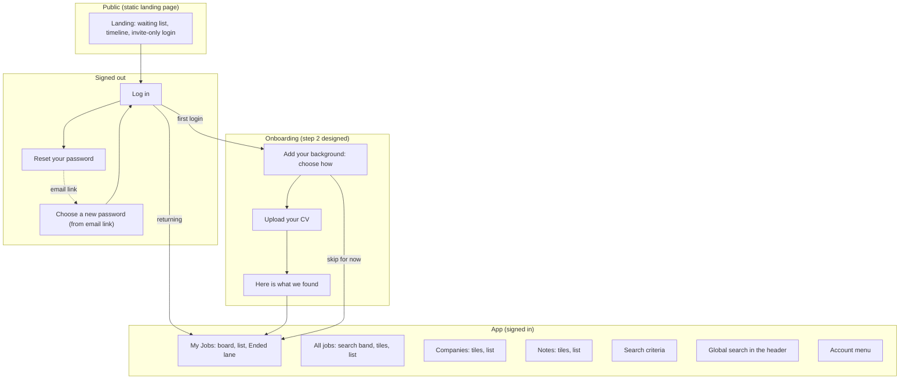
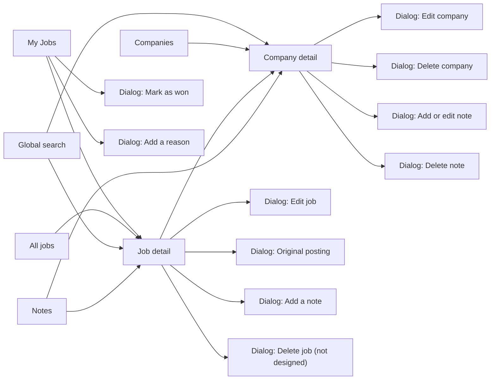
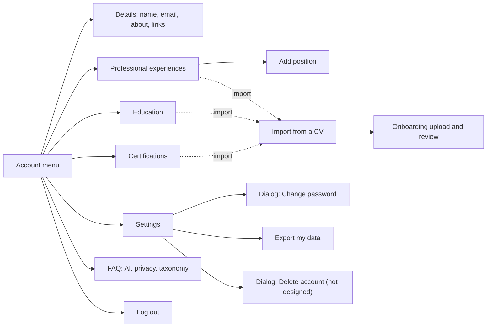
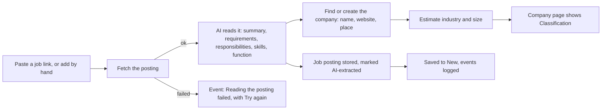
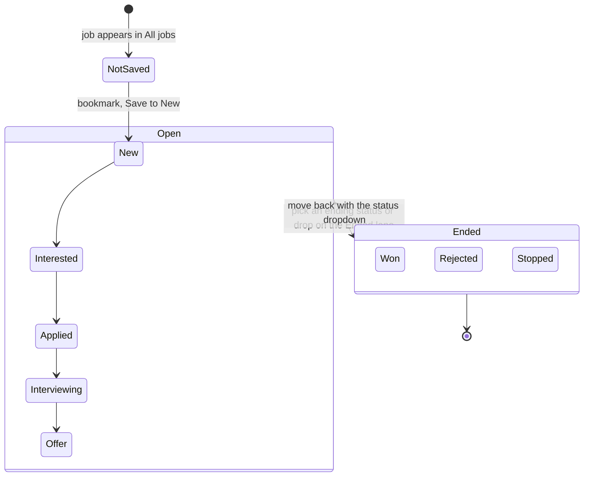
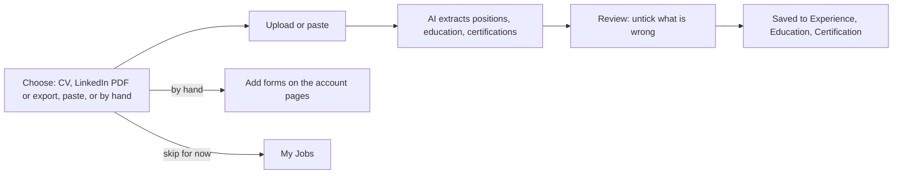

# Blueprint: pages and data model

Written 2026-10-26 from the Design canvas "CareerOS" and the conversation that produced it. The page map is the design as drawn. The data model is DERIVED from the screens: reconcile it with the repo's real schema before building anything from it.

## 1. Site map

### 1.1 Overview

### 1.2 Jobs, companies and notes

### 1.3 Account area

## 2. Screens (canvas artboards)

| Group | Artboards |
|---|---|
| Public | Landing page |
| Signed out | Log in, Reset your password, Choose a new password |
| Onboarding | Add your background, Upload your CV, Here is what we found |
| Jobs | My Jobs, My Jobs Ended lane, All jobs, Job detail, Edit job, Original posting, Add a note, Mark as won, Add a reason |
| Companies and notes | Companies, Company detail, Edit company, Delete company, Notes, Edit note, Delete note |
| Search | Search, Search (editing), Global search |
| Account | Account menu, Details, Professional experiences, Add position, Education, Certifications, Settings, Change password, FAQ |

Known staging routes: `/login`, `/experiences/new`, `/jobs/JOB-001`, `/companies/CO-001`. Other routes: unknown, ask.

## 3. Flows

### 3.1 Adding a job

### 3.2 Job status

Eight statuses: New, Interested, Applied, Interviewing, Offer are open; Won, Rejected, Stopped end a job. A status can be set from the dropdown on a card or by dropping the card on the Ended lane. Ending a job asks for an optional reason (No reason given, After interview, Experience did not match, Position filled, plus free text), saved as a note titled "Why this ended". Marking Won asks for confirmation.

### 3.3 Getting your background in

## 4. Data model

```mermaid
erDiagram
  USER ||--o{ USER_LINK : has
  USER ||--o| SEARCH_CRITERIA : has
  USER ||--o{ EXPERIENCE : has
  USER ||--o{ EDUCATION : has
  USER ||--o{ CERTIFICATION : has
  USER ||--o{ USER_JOB : tracks
  USER ||--o{ FOLLOW : makes
  USER ||--o{ NOTE : writes
  USER ||--o{ PASSWORD_RESET : requests
  USER ||--o{ IMPORT_RUN : starts
  INVITATION |o--o| USER : creates
  COMPANY ||--o{ JOB_POSTING : advertises
  COMPANY ||--o{ FOLLOW : followed_in
  COMPANY o|--o{ EXPERIENCE : linked_from
  COMPANY o|--o{ NOTE : parent_of
  COMPANY }o--o| INDUSTRY : estimated_in
  COMPANY }o--|| SIZE_CLASS : sized_as
  JOB_POSTING ||--o{ USER_JOB : saved_as
  JOB_POSTING ||--o| EXTRACTION : read_by
  JOB_POSTING }o--o| FUNCTION : classified_as
  JOB_POSTING }o--o{ SKILL : mentions
  USER_JOB ||--o{ JOB_EVENT : logs
  USER_JOB o|--o{ NOTE : parent_of
  EXPERIENCE ||--o{ EXPERIENCE_TAG : tagged
  USER {
    string id PK
    string name
    string email UK
    string password_hash
    string headline
    string location
    text about
    string theme "light, dark or system"
    datetime created_at
  }
  USER_LINK {
    string id PK
    string user_id FK
    string label "LinkedIn, GitHub, Website, other"
    string url
  }
  SEARCH_CRITERIA {
    string user_id PK
    list roles
    list must_haves
    list nice_to_haves
    list avoid
    text notes
  }
  EXPERIENCE {
    string id PK
    string user_id FK
    string title
    string start "YYYY-MM"
    string end "YYYY-MM or present"
    string company_name
    string company_id FK "optional link"
    string location
    int people_led
    text summary "2 to 4 sentences"
    text highlights "one per line"
    text detail "markdown"
    string experience_type "Employment, Guest lecture or teaching, Volunteer"
  }
  EXPERIENCE_TAG {
    string experience_id FK
    string kind "capability, domain knowledge, tool"
    string value
  }
  EDUCATION {
    string id PK
    string user_id FK
    string programme
    string institution
    string field_of_study "optional"
    string start_year
    string end_year "or expected"
    string grade "optional"
  }
  CERTIFICATION {
    string id PK
    string user_id FK
    string name
    string issuer
    string issued "YYYY-MM"
    string expires "YYYY-MM or none"
    string credential_id "optional"
    string credential_url "optional"
  }
  COMPANY {
    string id PK "CO-001"
    string name
    string website
    list locations
    string industry_id FK "estimated"
    string size_class FK "Micro to XL, or Unknown"
    string classified_by "AI or set by owner"
  }
  FOLLOW {
    string user_id FK
    string company_id FK
    datetime created_at
  }
  JOB_POSTING {
    string id PK "JOB-001"
    string company_id FK
    string title
    string url
    string source_domain
    string location
    bool remote_ok
    string workload "for example 100%"
    date posted_on
    string function_id FK
    text summary "AI-generated"
    list requirements_must "AI-extracted"
    list requirements_nice "AI-extracted"
    list languages "AI-extracted"
    list responsibilities "AI-extracted"
    bool closed
    datetime added_at
  }
  EXTRACTION {
    string id PK
    string job_posting_id FK
    string state "fetched, read or failed"
    datetime read_at
    list not_found "field names"
  }
  USER_JOB {
    string id PK
    string user_id FK
    string job_posting_id FK
    string status "8 values"
    string end_reason "optional"
    bool needs_input
    datetime saved_at "bookmark creates New"
  }
  JOB_EVENT {
    string id PK
    string user_job_id FK
    string type "added, fetched, read, failed, status changed"
    string from_status
    string to_status
    datetime at
  }
  NOTE {
    string id PK
    string user_id FK
    string company_id FK "one parent only"
    string user_job_id FK "one parent only"
    string title
    text body
    datetime created_at
  }
  INDUSTRY {
    string id PK
    string name "ISIC section, internal only"
  }
  SIZE_CLASS {
    string id PK
    string name "Micro, Small, Medium, Large, XL, Unknown"
  }
  FUNCTION {
    string id PK
    string name
  }
  SKILL {
    string id PK
    string name "ESCO later"
  }
  INVITATION {
    string id PK
    string email
    string token_hash
    datetime expires_at
  }
  PASSWORD_RESET {
    string id PK
    string user_id FK
    string token_hash
    datetime expires_at
    datetime used_at
  }
  IMPORT_RUN {
    string id PK
    string user_id FK
    string source "cv, linkedin pdf, linkedin export, paste"
    string state "uploaded, read, reviewed, applied"
    json extracted_items
  }
  WAITLIST_ENTRY {
    string id PK
    string email
    datetime created_at
  }
```

### Enumerations

| Name | Values |
|---|---|
| Job status | New, Interested, Applied, Interviewing, Offer, Won, Rejected, Stopped |
| End reason | No reason given, After interview, Experience did not match, Position filled |
| Experience type | Employment, Guest lecture or teaching, Volunteer |
| Experience tag kind | Capability, Domain knowledge, Tool |
| Company size class | Micro, Small, Medium, Large, XL, Unknown (EU classes) |
| Job event | Job added, Posting fetched, Reading the posting failed, Details read from the posting, Status changed from A to B |
| Provenance | AI-generated (text the model wrote), AI-extracted (text lifted from the posting) |
| Certification status (derived) | Valid, Expires in N months, Expired |
| Education status (derived) | Completed, In progress |
| Theme | Light, Dark, Match device |
| Import source | CV, LinkedIn PDF, LinkedIn data export, pasted text |

### Modelling notes

- **Shared and personal.** COMPANY and JOB_POSTING are shared records (the future Job Universe). USER_JOB and FOLLOW are one person's relationship to them. Today the app is single-user, so USER_JOB may still be columns on the job; the split is the target for the hosted product.
- **Notes have exactly one parent**, a company or a job, never both and never neither.
- **Company classification** (industry and size) is estimated by AI or set by the owner ("Set it yourself", "Try again"). The industry list is the ISIC section list internally; public copy never says so.
- **Not built, not designed:** fit scores, job discovery, logos, ratings, ISCO occupations, ESCO skills (SKILL is a placeholder), contract type and language filters.
- **IDs** look like CO-001 and JOB-001 in the staging app.
- **Never promise matching publicly.**

## 5. What we learned (design decisions)

1. **Colour:** the blue was dropped; Spabattical teal was considered, then Matchacado green 500 (`#008753`). Pastel panels and grey-on-grey chips were rejected. The grey board panel was "sad" and became solid brand green. Light green page (`#f6fdf5`) reduces eye strain.
2. **Consolidation:** landing values win; font, dark mode and components from the old product system; Gestalt 177 pinned.
3. **Selected states** use `brand-wash` and a 2px brand border, never the primary fill. On the green search band selected chips are solid black.
4. **Chips and switches:** chips are small (32px, 14px bold); view switches are a SegmentedControl.
5. **One layout for lists** (CollectionPage): heading and one primary action, one toolbar row (filters and count at the left, view switch at the right), tiles or table.
6. **Cards:** fixed height, cut-off text, no logo, no rating. Job card version 3 (footer with time and control); company tile version 2 (facts grid with dashes).
7. **Bookmark** = keep an eye on this: save a job to New, follow a company.
8. **Destructive:** red fill only on the confirm button inside a delete dialog; triggers are gray with a red icon and label.
9. **Dialogs:** one pattern; one always-enabled primary; context line "Saved to ..." for notes.
10. **Header:** five main links, global search, one Account menu with Log out at the bottom. Experiences, Taxonomy and Profile moved under Account.
11. **Details moved off the job page:** extraction info and the original posting live in an "Original posting" dialog.
12. **No duplicate facts** on one page (company sector and size appear once).
13. **Account pages** share a left list and 24px spacing.
14. **Import:** CV upload is the quickest route; LinkedIn works through its PDF or data export because CareerOS cannot log in to LinkedIn; everything is reviewed before it is saved.
15. **Copy rules:** plain, direct; disclose the AI provider before sign-in; sample data is labelled as examples; no academic taxonomy names in public copy.
16. **Password reset** never reveals whether an address has an account.
